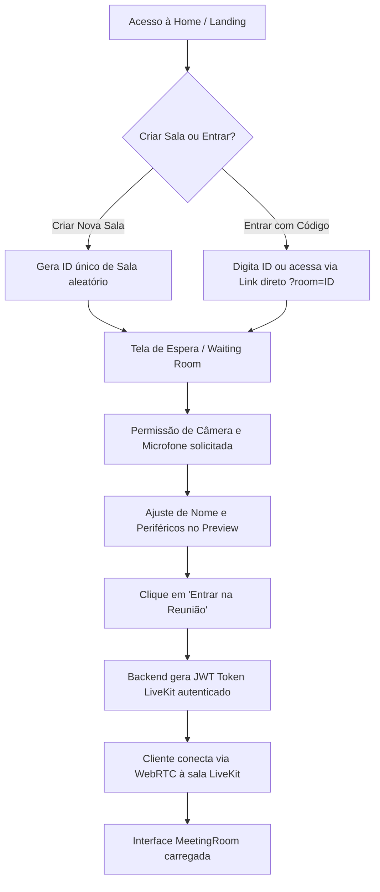
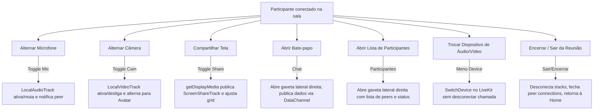
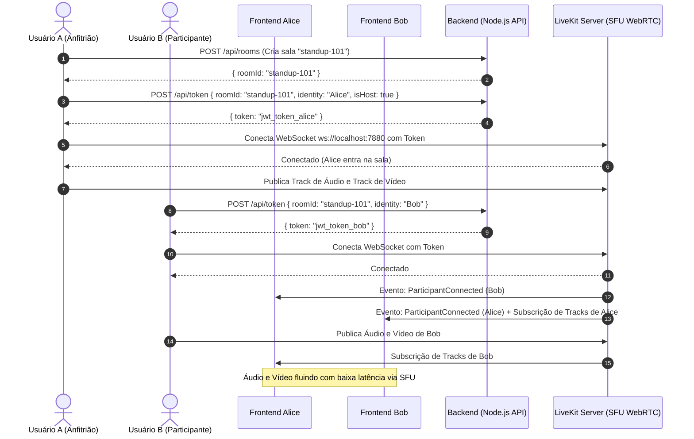

# Fluxos de Usuário (User Flows)

Este documento descreve os fluxos operacionais completos da aplicação de videoconferência baseada no Zoom.

---

## 1. Fluxo de Criação e Ingresso na Reunião

---

## 2. Fluxo em Reunião (In-Meeting Lifecycle)

---

## 3. Fluxo de Mídia e Sinalização WebRTC (LiveKit Architecture)

---

## 4. Tratamento de Exceções e Reconexão

- **Queda de Conexão (Network Blip)**:
  - O LiveKit dispara o evento `RoomEvent.Reconnecting`.
  - A interface exibe no cabeçalho um alerta em amarelo com spinner: `Reconectando à reunião...`.
  - Todos os estados locais de mute/unmute são preservados.
  - Ao restabelecer (`RoomEvent.Reconnected`), o alerta some e as tracks são revalidadas.
  - Se a reconexão falhar após 15 segundos, o status transita para `Disconnected` e exibe opção de tentar novamente ou retornar ao início.
- **Permissão de Câmera/Microfone Negada**:
  - A interface captura o erro `NotAllowedError` e inicializa o usuário no modo "somente ouvinte", exibindo um toast instruindo a liberar as permissões no navegador.
